# Secure Connect and Communication Platform

## Project overview

Secure Connect and Communication Platform is a Node.js backend project demonstrating account registration and login, protected personal notes, administrator-only endpoints, and real-time room-based chat. It uses MongoDB for persistence, bcrypt for password hashing, JWTs for authentication, Socket.IO for live communication, and Node.js `EventEmitter` for application events.

The project is designed for local development and API testing with Postman. The screenshots included below are the image files currently present in `screenshots/`; no additional test captures are implied.

## Features

- Register and authenticate users using hashed passwords and signed, expiring JWTs.
- Protect endpoints with authentication and role-based authorization.
- Create, list, read, update, and delete notes scoped to the authenticated user.
- Provide admin-only user listing and database statistics endpoints.
- Authenticate Socket.IO connections using a JWT, then chat in rooms.
- Emit and log registration, login, note, connection, and chat events with `EventEmitter`.
- Check server and database availability using a health endpoint.
- Supply an importable Postman collection and a local environment template.

## Technology stack

| Technology | Use |
|---|---|
| Node.js | JavaScript runtime and built-in `EventEmitter` |
| Express | HTTP server, routes, and middleware |
| MongoDB | Persistent user and note data, accessed through the official Node.js driver |
| JWT (`jsonwebtoken`) | Signed tokens for HTTP and Socket.IO authentication |
| bcrypt | Password hashing and verification |
| dotenv | Load local environment configuration from `.env` |
| Socket.IO | Authenticated real-time connections and room-based chat |

## Installation and setup

### Prerequisites

- Node.js 18 or newer and npm
- MongoDB Community Server running locally, or access to another MongoDB deployment
- Postman, if you want to run the supplied API collection

### Windows / PowerShell

From the project directory:

1. Install dependencies:

   ```powershell
   npm install
   ```

2. Create a local environment file from the template:

   ```powershell
   Copy-Item .env.example .env
   notepad .env
   ```

3. Replace the template values as described below. In particular, set a unique `JWT_SECRET` of at least 32 characters and choose private admin credentials. Do not share or commit `.env`.
4. Start MongoDB. The template's local URI uses `127.0.0.1:27017` and the `secure_connect_db` database.
5. Start the server:

   ```powershell
   npm start
   ```

   The default base URL is `http://localhost:5000`. To restart automatically during development, use `npm run dev`.

The application validates its required configuration and connects to MongoDB at startup. Startup reports an error if required settings are invalid or the database cannot be reached. On startup, the configured admin account is created if needed; if the same admin email already exists as a non-admin account, startup fails.

## Environment variables

The server loads settings from `.env` through `dotenv`. Copy `.env.example` and replace its example credentials and signing secret before running the server. Do not paste real secrets into this README, Postman screenshots, or version control.

| Variable | Required | Purpose and validation |
|---|---:|---|
| `PORT` | No | HTTP port; defaults to `5000` and must be between 1 and 65535. |
| `MONGODB_URI` | Yes | MongoDB connection URI, for example a local development database URI. |
| `JWT_SECRET` | Yes | Private token-signing secret; must be at least 32 characters and cannot be the template default. |
| `JWT_EXPIRES_IN` | Yes | Token lifetime, such as `1h`. |
| `BCRYPT_SALT_ROUNDS` | Yes | bcrypt work factor; must be an integer from 4 to 31. |
| `ADMIN_USERNAME` | Yes | Username for the configured administrator. |
| `ADMIN_EMAIL` | Yes | Valid email used to initialize/find the administrator account. |
| `ADMIN_PASSWORD` | Yes | Password used to initialize/update the configured administrator account. |

The chat client also accepts optional process environment variables: `SOCKET_TOKEN` (a JWT obtained by logging in), `CHAT_SERVER_URL` (defaults to `http://localhost:5000`), and `CHAT_ROOM` (defaults to `general`). These are for running the local chat client, not required server settings.

## API reference and example requests

Base URL: `http://localhost:5000`. JSON bodies use `Content-Type: application/json`. For protected requests, replace `<user-jwt>` or `<admin-jwt>` with a token returned by the login endpoint:

```http
Authorization: Bearer <user-jwt>
```

The examples below use `curl.exe`, available in Windows. Request examples use placeholders only; do not put real passwords or tokens in shared files.

| Method | Endpoint | Access | Example request |
|---|---|---|---|
| `GET` | `/api/health` | Public | `curl.exe -i http://localhost:5000/api/health` |
| `POST` | `/api/auth/signup` | Public | See signup example below. |
| `POST` | `/api/auth/login` | Public | See user or admin login example below. |
| `GET` | `/api/auth/me` | User JWT | `curl.exe -i -H "Authorization: Bearer <user-jwt>" http://localhost:5000/api/auth/me` |
| `POST` | `/api/notes` | User JWT | See create-note example below. |
| `GET` | `/api/notes` | User JWT | `curl.exe -i -H "Authorization: Bearer <user-jwt>" http://localhost:5000/api/notes` |
| `GET` | `/api/notes/:id` | User JWT | `curl.exe -i -H "Authorization: Bearer <user-jwt>" http://localhost:5000/api/notes/NOTE_ID` |
| `PUT` | `/api/notes/:id` | User JWT | See update-note example below. |
| `DELETE` | `/api/notes/:id` | User JWT | `curl.exe -i -X DELETE -H "Authorization: Bearer <user-jwt>" http://localhost:5000/api/notes/NOTE_ID` |
| `GET` | `/api/admin/users` | Admin JWT | `curl.exe -i -H "Authorization: Bearer <admin-jwt>" http://localhost:5000/api/admin/users` |
| `GET` | `/api/admin/users/:id` | Admin JWT | `curl.exe -i -H "Authorization: Bearer <admin-jwt>" http://localhost:5000/api/admin/users/USER_ID` |
| `GET` | `/api/admin/stats` | Admin JWT | `curl.exe -i -H "Authorization: Bearer <admin-jwt>" http://localhost:5000/api/admin/stats` |

### Signup

`POST /api/auth/signup` creates a regular user. Any submitted `role` field is ignored.

```powershell
curl.exe -i -X POST http://localhost:5000/api/auth/signup `
  -H "Content-Type: application/json" `
  --data-raw '{"username":"sample-user","email":"user@example.com","password":"<user-password>"}'
```

### Login

`POST /api/auth/login` returns a JWT on successful login. Use the same endpoint for an administrator, with the credentials configured in `.env`.

```powershell
curl.exe -i -X POST http://localhost:5000/api/auth/login `
  -H "Content-Type: application/json" `
  --data-raw '{"email":"user@example.com","password":"<user-password>"}'
```

### Create, update, and delete notes

`POST /api/notes` creates a note for the authenticated user. The server takes ownership from the JWT, not from the request body.

```powershell
curl.exe -i -X POST http://localhost:5000/api/notes `
  -H "Authorization: Bearer <user-jwt>" `
  -H "Content-Type: application/json" `
  --data-raw '{"title":"My first note","content":"Example note text"}'
```

`PUT /api/notes/:id` updates both note fields. `GET /api/notes/:id` reads a note, and `DELETE /api/notes/:id` deletes it. Replace `NOTE_ID` with the `_id` returned by note creation.

```powershell
curl.exe -i -X PUT http://localhost:5000/api/notes/NOTE_ID `
  -H "Authorization: Bearer <user-jwt>" `
  -H "Content-Type: application/json" `
  --data-raw '{"title":"Updated note","content":"Updated example text"}'
```

### Authorization and response behavior

- `/api/auth/me` and all `/api/notes` endpoints require a valid user JWT.
- All `/api/admin` endpoints require a valid admin JWT. A regular user is denied access.
- Note reads and changes are restricted to the note owner; another user's note is returned as not found.
- Signup returns `201`; login and reads return `200`; invalid input returns `400`; invalid credentials return `401`; missing tokens return `403`; duplicate signup email returns `409`.
- The admin user list and individual user responses omit password hashes.

See [docs/API_DOCUMENTATION.md](docs/API_DOCUMENTATION.md) for additional request, response, and error details.

## Postman API Testing Screenshots

The following are the actual image files currently in `screenshots/`. Their filenames include the `.png.png` extension, so the links use those exact relative paths.

1. **Health check**
   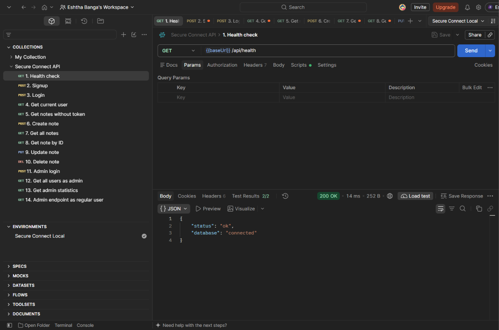
2. **Signup**
   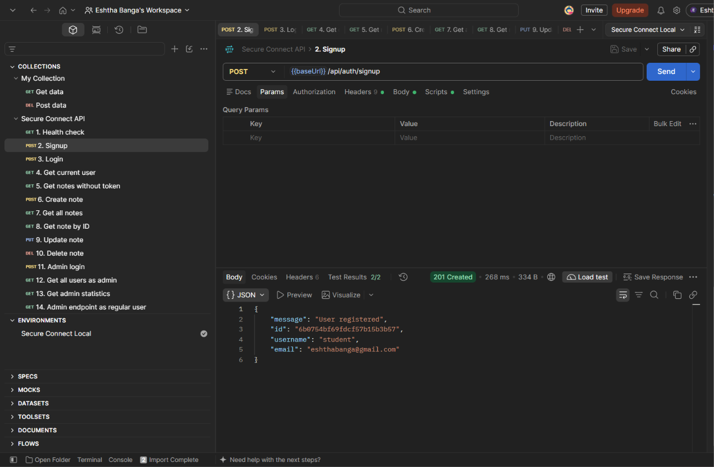
3. **Login**
   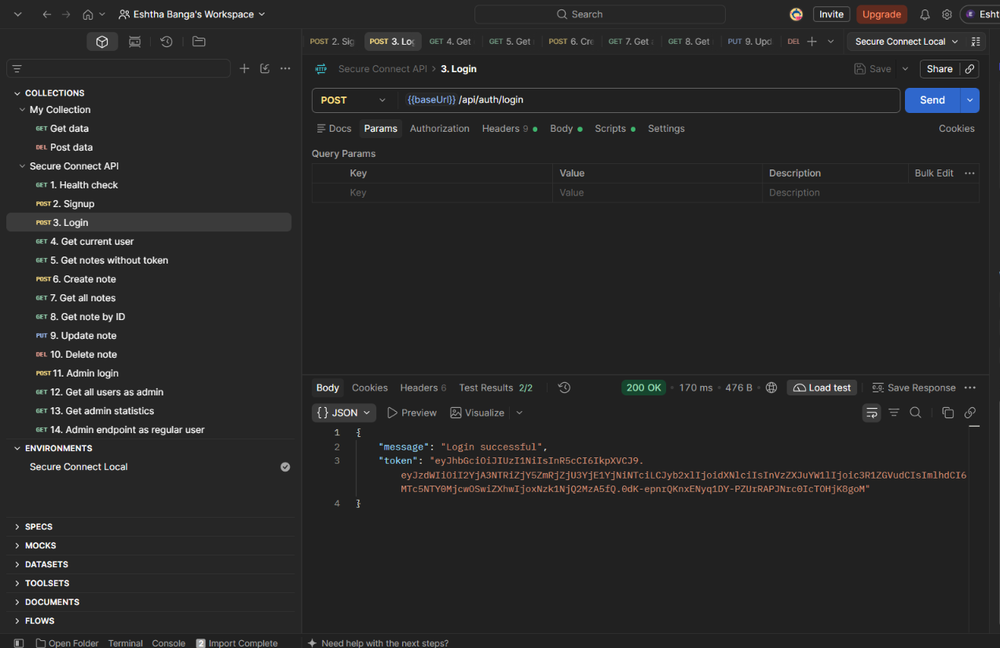
4. **Current user**
   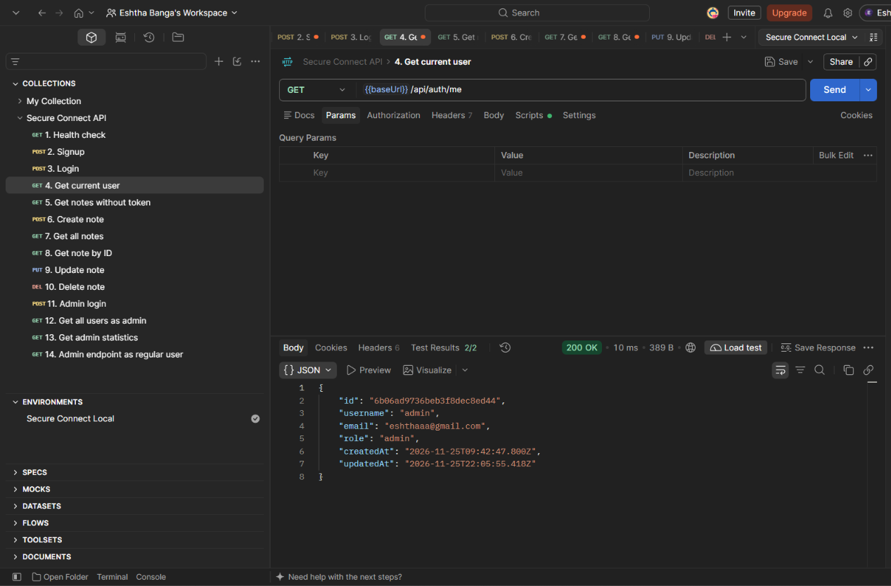
5. **Unauthorized notes request**
   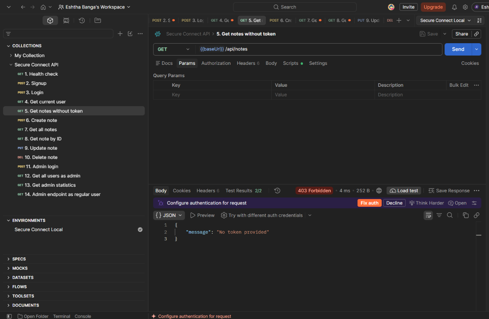
6. **Create note**
   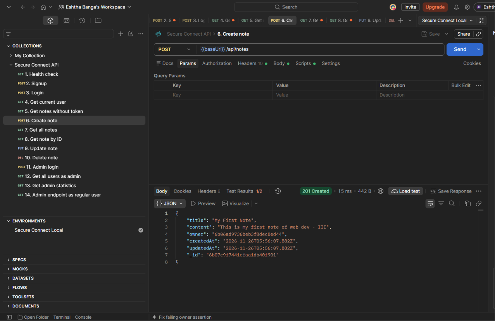
7. **List notes**
   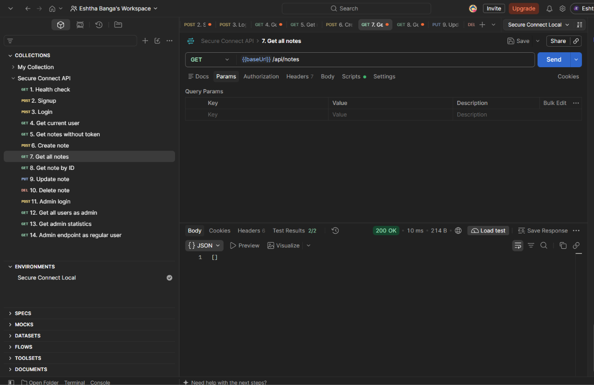
8. **Get note**
   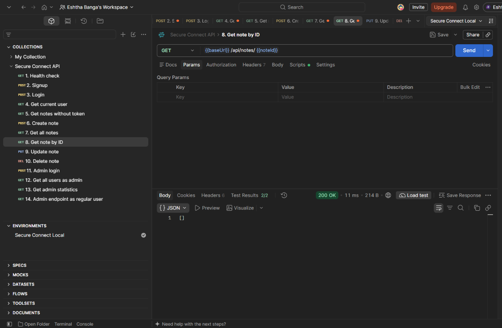
9. **Update note**
   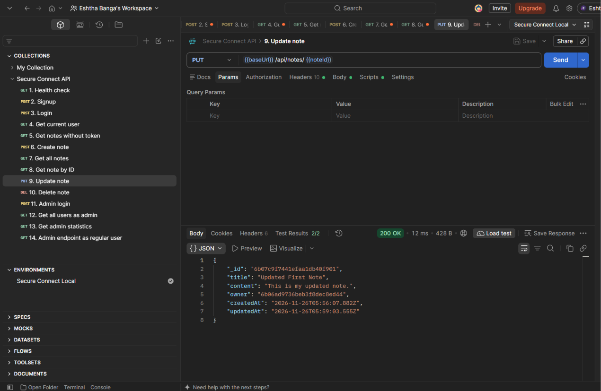
10. **Delete note**
    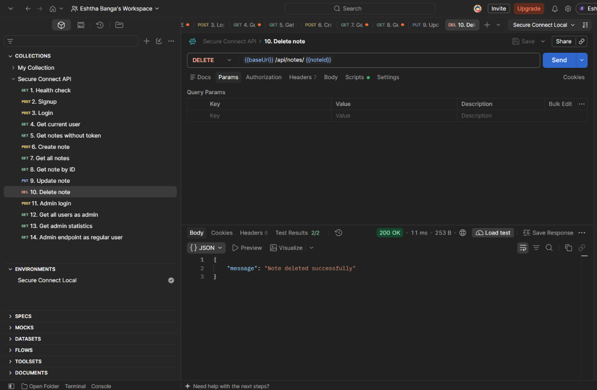
11. **Admin login**
    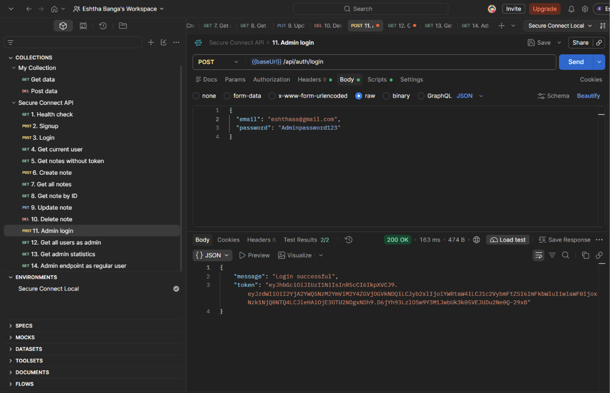
12. **Admin users**
    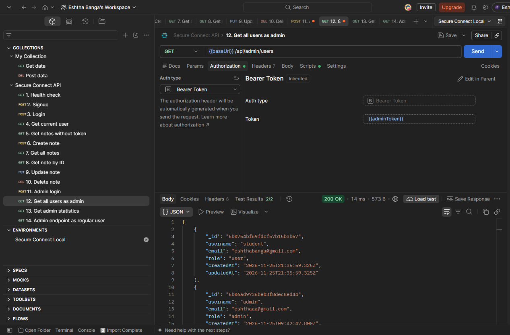
13. **Admin statistics**
    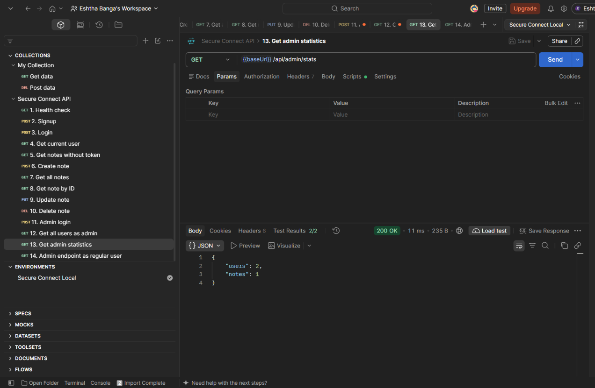
14. **Regular user denied admin access**
    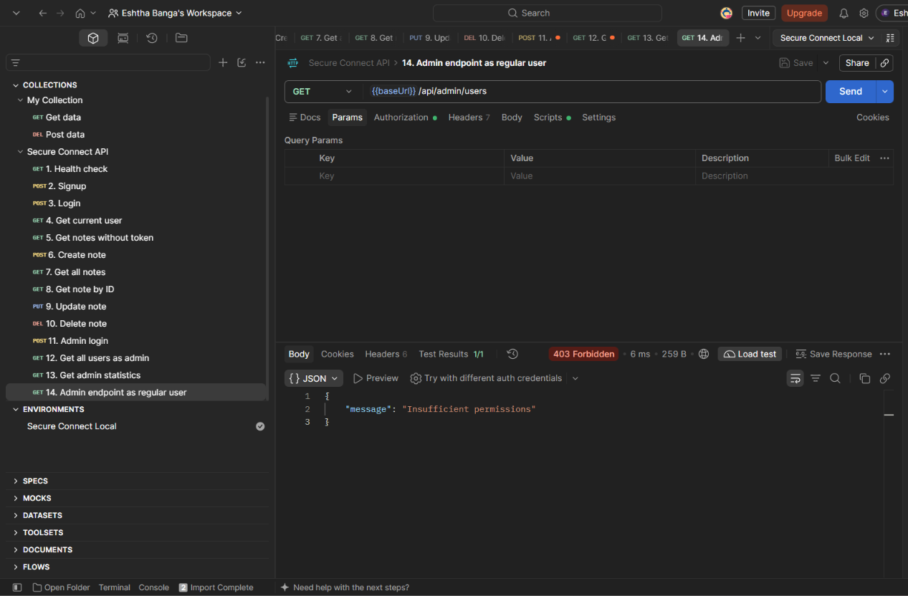

To repeat the requests, import `postman/Secure_Connect_API.postman_collection.json` and `postman/Secure_Connect_Local.postman_environment.json` into Postman, select the local environment, and set its admin credentials to match `.env`. Run the collection requests in order. Use a fresh test-user email for each run or remove the previous test user from the local database. Protect screenshots and exports from exposing real passwords or JWTs.

## Socket.IO and EventEmitter testing screenshots

There are currently no Socket.IO or EventEmitter screenshot files in `screenshots/`, so none are embedded or represented as completed test evidence here. The steps below describe how to exercise these features and capture your own genuine screenshots for submission.

1. Start the project with `npm start` and log in as two different users using `POST /api/auth/login`.
2. In two separate PowerShell windows, set each window's `SOCKET_TOKEN` to a different returned JWT and start the chat client:

   ```powershell
   $env:SOCKET_TOKEN = "<user-jwt>"
   npm run chat
   ```

3. Send a message in one window and observe it in the other user's `general` room. The client also supports `/join <room>`, `/leave <room>`, and `/quit`.
4. Observe the server console for `EventEmitter` logs generated by user registration/login, note operations, connections, and chat messages.
5. Capture the actual client/server behavior yourself. For example, save redacted captures as `screenshots/15-socketio-chat.png` and `screenshots/16-eventemitter-logs.png`, then add Markdown image references to those files only after they exist. Keep tokens and private data out of captures.

Socket.IO clients authenticate with `{ auth: { token: "<JWT>" } }`. They join `general` on connection. The client events are `joinRoom`, `chatMessage`, and `leaveRoom`; server events include `roomJoined`, `userJoined`, `receiveMessage`, `userLeft`, and `errorMessage`. `EventEmitter` is Node.js's built-in event system; application listeners are initialized when the server starts.

## Running locally

Once dependencies, `.env`, and MongoDB are ready:

```powershell
npm start
```

Open `http://localhost:5000/api/health` or send the documented API requests to verify the local server/database response. For development auto-restart, run `npm run dev`. To run the project's Node.js test suite, run `npm test` with its configured local MongoDB available.

## `.gitignore`

The repository's [.gitignore](.gitignore) excludes `node_modules/` and `.env` (as well as debug logs, coverage output, and `.DS_Store`). Keep local secrets in the ignored `.env` file and commit only safe configuration templates such as `.env.example`.
